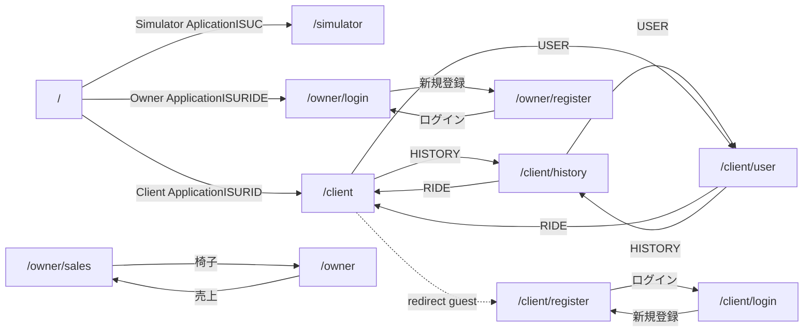

# App analysis report

- crawl: 2026-10-29T13:29:42.236Z (screens/API calls are from this crawl)
- code read: 6484a0d at 2026-10-29T13:29:42.492Z (handler → tables, data model)
- baseURL: https://isuride.xiv.isucon.net
- screens: 14, flows: 1, distinct endpoints observed: 13, API requests recorded: 818

> The benchmarker calls the API directly. Request counts here reflect the browser UI; use the access log for bench behaviour.

<!-- bench:start -->
## Now — what to solve next (bench run 20261029-135253, vs 20261029-134923; refreshed 2026-10-29T13:56:21.604Z)

Next step (report rules):
1. 特別賞を取りに行く（app 2 台 + 計測 OFF で 1 ベンチ） — `score-sprint skill で。対象 run は 20261029-135253`
2. deep-dive — `task deepdive TS=20261029-135253 → deep-dive skill`
3. 構成変更: 空いている host に処理を移す — `TECHNIQUES T26（app 2 台 + host 固定の endpoint は nginx で寄せる）/ T27（付随サービス）`

| # | what | pts | share | p99 ms | score | fix | to do | rules |
|---|---|---|---|---|---|---|---|---|
| 1 | `GET /api/chair/notification` | 106 | 36% | 303 |  | parallel-fix file:chair_handlers.go | regression 9→75 ms; ポーリングを軽くする（応答のキャッシュ / 304 / 間隔の指定）: GET /api/chair/notification; この endpoint の処理を軽くする（chair_handlers.go） | 通知は全状態遷移を発生順にat least once返す。飛ばす・逆転はクリティカルでFAIL; 通知は状態変化から3秒以内。マッチ後の通知は30秒の猶予; SSEにするならContent-Type text/event-stream、接続直後に最新のライド状態を送る; notificationは60秒、initializeは30秒、他は10秒でタイムアウト。登録APIは処理全体20秒 |
| 2 | `GET /api/app/notification` | 101 | 20% | 311 | loop | parallel-fix file:app_handlers.go | regression 14→81 ms; ポーリングを軽くする（応答のキャッシュ / 304 / 間隔の指定）: GET /api/app/notification; 重い集計 SQL を減らす（1 回にまとめる / 結果をキャッシュ / 集計列）: SELECT r.id AS ride_id, r.evaluation, rs.status FROM rides r JOIN rid… | 通知は全状態遷移を発生順にat least once返す。飛ばす・逆転はクリティカルでFAIL; 通知は状態変化から3秒以内。マッチ後の通知は30秒の猶予; SSEにするならContent-Type text/event-stream、接続直後に最新のライド状態を送る; notificationは60秒、initializeは30秒、他は10秒でタイムアウト。登録APIは処理全体20秒 |
| 3 | `POST /api/chair/coordinate` | 99 | 29% | 253 |  | parallel-fix file:chair_handlers.go | regression 12→61 ms; この endpoint の処理を軽くする（chair_handlers.go）; ポーリングを軽くする（応答のキャッシュ / 304 / 間隔の指定）: POST /api/chair/coordinate | nearby-chairsの座標は過去3秒以内にcoordinateで送られた座標と一致; owner/chairsの総走行距離はcoordinateから3秒以内に反映; スコア = マッチ位置→乗車位置の距離×0.1 + 乗車位置→目的地の距離 + 完了ライド数×5 |
| 4 | `GET /api/app/nearby-chairs` | 74 | 7% | 2642 | loop | parallel-fix file:app_handlers.go | regression 106→434 ms; 重い集計 SQL を減らす（1 回にまとめる / 結果をキャッシュ / 集計列）: SELECT c.id, c.name, c.model, cl.latitude, cl.longitude FROM chairs c… | nearby-chairsの座標は過去3秒以内にcoordinateで送られた座標と一致 |
| 5 | `GET /api/owner/chairs` | 62 | 2% | 2907 |  | parallel-fix file:owner_handlers.go | regression 281→1011 ms; この endpoint の処理を軽くする（owner_handlers.go）; 重い集計 SQL を減らす（1 回にまとめる / 結果をキャッシュ / 集計列）: SELECT id, owner_id, name, access_token, model, is_active, created_at… | owner/chairsの総走行距離はcoordinateから3秒以内に反映 |
| 6 | `POST /api/app/rides/:id/evaluation` | 54 | 1% | 759 | score | investigate (deep-dive) | regression 105→223 ms; 悪化の原因を探す（前の run との差分 / deep-dive） | 二重請求・未払い・誤った金額はクリティカル。リトライは支払履歴かIdempotency-Keyで冪等に。負荷終了後5秒以内に決済完了; スコア = マッチ位置→乗車位置の距離×0.1 + 乗車位置→目的地の距離 + 完了ライド数×5 |
| 7 | `GET /api/app/rides` | 52 | 1% | 319 | loop | investigate (deep-dive) | regression 8→58 ms; 悪化の原因を探す（前の run との差分 / deep-dive） |  |

(+11 more open items)

Resolved: Speed up GET /api/app/notification (avg 14ms, 35% of request time), CPU hot spot: main.appGetNotification (18% of the app's CPU), Periodic job GET /api/internal/matching: every 558 ms, ≈ 1.0 writes per call, CPU hot spot: main.chairGetNotification (15% of the app's CPU), CPU hot spot: main.chairPostCoordinate (14% of the app's CPU), Add an index on coupons(used_by), Query on ride_statuses is still slow with its index (4% of SQL time), GET /api/owner/chairs (share 6%→2%)
<!-- bench:end -->

## System (from the repo mirror of /home/isucon: etc/, env.sh, server-info)

| unit | ExecStart | WorkingDirectory | depends on |
|---|---|---|---|
| `isuride-go.service` | `/home/isucon/webapp/go/isuride` | `/home/isucon/webapp/go` | mysql.service |
| `isuride-matcher.service` | `/bin/sh -c "while true; do curl -s https://isuride.xiv.isucon.net/api/internal/matching; sleep $ISUCON_MATCHING_INTERVAL; done"` |  | isuride-go.service |
| `isuride-node.service` | `/home/isucon/.x npm run start` | `/home/isucon/webapp/nodejs` | mysql.service |
| `isuride-payment_mock.service` | `/home/isucon/webapp/payment_mock/payment_mock` | `/home/isucon/webapp/payment_mock` | mysql.service |
| `isuride-perl.service` | `/home/isucon/.x ./local/bin/plackup -s Starlet -p 8080 -Ilib app.psgi` | `/home/isucon/webapp/perl` | mysql.service |
| `isuride-php.service` | `/home/isucon/.x php-fpm --fpm-config /home/isucon/local/php/etc/isuride.php-fpm.conf` | `/home/isucon/webapp/php` | mysql.service |
| `isuride-python.service` | `/home/isucon/webapp/python/.venv/bin/gunicorn` | `/home/isucon/webapp/python` | mysql.service |
| `isuride-ruby.service` | `/home/isucon/.x bundle exec puma --bind tcp://0.0.0.0:8080 --workers 8 --threads 0:8 --environment production` | `/home/isucon/webapp/ruby` | mysql.service |
| `isuride-rust.service` | `/home/isucon/webapp/rust/target/release/isuride` | `/home/isucon/webapp/rust` | mysql.service |

| nginx server_name | listen | root | locations |
|---|---|---|---|
| `_` | 80 default_server | `/var/www/html` | `/ → static ($uri $uri/ =404)` |
| `_` | 443 ssl default_server | `/var/www/html` | `/ → static ($uri $uri/ =404)` |
| `xiv.isucon.net *.xiv.isucon.net` | 443 ssl | `/home/isucon/webapp/public/` | `/ → static ($uri /index.html)` `/api/ → proxy http://localhost:8080` `/api/internal/ → proxy http://localhost:8080` |

Storage: **MySQL** etc/mysql/mysql.conf.d

server-info: NOTE: SQLite database: /var/lib/fwupd/pending.db (45056 bytes); NOTE: SQLite database: /var/lib/PackageKit/transactions.db (32768 bytes); NOTE: SQLite database: /var/lib/command-not-found/commands.db (4009984 bytes); NOTE: fwupd (pid 3080) has open: /var/cache/fwupd/quirks.db; NOTE: fwupd (pid 3080) has open: /var/lib/fwupd/pending.db

Code (../../webapp/go): 8 Go files, 2096 lines, 36 funcs, 18 routes, 69 SQL literals; schema 10 tables, 56 columns, 16 secondary indexes. Biggest files: app_handlers.go (1007 lines, 42 SQL), chair_handlers.go (339 lines, 15 SQL), owner_handlers.go (242 lines, 4 SQL), main.go (185 lines, 1 SQL), payment_gateway.go (98 lines, 0 SQL)

env.sh keys: `ISUCON_DB_HOST` `ISUCON_DB_PORT` `ISUCON_DB_USER` `ISUCON_DB_PASSWORD` `ISUCON_DB_NAME` `ISUCON_MATCHING_INTERVAL`

## Service summary (auto)

| actor | screens | endpoints (read/write) | polling | resources seen in paths |
|---|---|---|---|---|
| user | `/simulator` `/client/register` `/client/history` `/client` `/client/user` `/simulator` | 7 (3/4) | 1 | notification, nearby-chairs, rides, payment-methods, estimated-fare, evaluation |
| chair | `/simulator` `/simulator` | 4 (1/3) | 1 | notification, coordinate, activity, rides, status |
| owner | `/owner/sales` `/owner` | 2 (2/0) | 0 | chairs, sales |

## Top findings (behaviour)

- **[high] 2 polling endpoint(s) = 97% of observed requests** GET /api/app/notification (~70ms gap, median 22ms); GET /api/chair/notification (~61ms gap, median 18ms). Server-directed interval field(s) in the response: retry_after_ms=30 → raising the value or switching to SSE changes client behaviour.
- **[high] 1 internal endpoint(s) never called by the UI — server-side batch candidates** GET /api/internal/matching (internalGetMatching → rides, chairs, ride_statuses). Who calls it, how often, how many items per call? This often bounds throughput.
- **[info] Repeated write(s) from clients: POST /api/chair/coordinate** POST /api/chair/coordinate every ~225ms in user:flow:ride-lifecycle. Under the bench this is the main write stream; consider batching / async writes.
- **[info] Write hot path: POST /api/chair/coordinate (9 calls, median 20ms)** position report; chairPostCoordinate → chair_locations, rides, ride_statuses. Other writes: POST /api/chair/activity, POST /api/chair/rides/:id/status, POST /api/app/payment-methods, POST /api/app/rides/estimated-fare
- **[info] State machine observed in flow:ride-lifecycle: COMPLETED → MATCHING → ENROUTE → PICKUP → CARRYING → ARRIVED** COMPLETED→MATCHING: POST /api/app/rides [user]; MATCHING→ENROUTE: POST /api/chair/rides/:id/status [chair]; ENROUTE→PICKUP: POST /api/chair/coordinate [chair]; PICKUP→CARRYING: POST /api/chair/rides/:id/status [chair]; CARRYING→ARRIVED: POST /api/chair/coordinate [chair]; ARRIVED→COMPLETED: POST /api/app/rides/:id/evaluation [user]
- **[info] 1 handler(s) call an external HTTP service** POST /api/app/rides/:id/evaluation → appPostRideEvaluatation. Latency and retries there are outside DB tuning.
- **[info] 0 app-origin error(s); 8 crawl artefact(s) (missing cookie, re-run duplicates, aborted)** DB error text leaks to clients on: POST /api/app/payment-methods — handlers are thin; expect little validation around writes.

## Performance hints — code snapshot at crawl time (the bench report is the source of truth; these go stale after the first fix round)

- **[high] 2 endpoint(s) slow even without load (≥300ms)** GET /api/owner/sales 1218ms [aggregate (range); ownerGetSales → chairs, rides, ride_statuses; SQL in loop]; GET /api/owner/chairs 826ms [read; ownerGetChairs → chairs, chair_locations]
- **[high] 5 handler(s) run SQL inside a loop (N+1 suspects)** GET /api/app/notification → appGetNotification (10 SQL; rides, ride_statuses, chairs, coupons); GET /api/app/nearby-chairs → appGetNearbyChairs (5 SQL; chairs, rides, chair_locations, ride_statuses); GET /api/app/rides → appGetRides (7 SQL; rides, chairs, owners, ride_statuses, coupons); GET /api/owner/sales → ownerGetSales (2 SQL; chairs, rides, ride_statuses); POST /api/app/rides → appPostRides (15 SQL; rides, ride_statuses, coupons)

## Data model (../../webapp/sql/1-schema.sql) — rows: run `task db:snapshot LABEL=latest` after a bench to fill in

| table | rows | columns | indexes | refers to |
|---|---|---|---|---|
| settings |  | name (PK), value | PRIMARY(name) |  |
| chair_models |  | name (PK), speed | PRIMARY(name) |  |
| chairs |  | id (PK), owner_id, name, model, is_active, access_token, created_at, updated_at | PRIMARY(id) | owner_id → owners |
| chair_locations |  | id (PK), chair_id, latitude, longitude, created_at | PRIMARY(id) | chair_id → chairs |
| users |  | id (PK), username (idx), firstname, lastname, date_of_birth, access_token (idx), invitation_code (idx), created_at, updated_at | PRIMARY(id), idx(username), idx(access_token), idx(invitation_code) |  |
| payment_tokens |  | user_id (PK), token, created_at | PRIMARY(user_id) | user_id → users |
| rides |  | id (PK), user_id, chair_id, pickup_latitude, pickup_longitude, destination_latitude, destination_longitude, evaluation, created_at, updated_at | PRIMARY(id) | user_id → users, chair_id → chairs |
| ride_statuses |  | id (PK), ride_id, status, created_at, app_sent_at, chair_sent_at | PRIMARY(id) | ride_id → rides |
| owners |  | id (PK), name (idx), access_token (idx), chair_register_token (idx), created_at, updated_at | PRIMARY(id), idx(name), idx(access_token), idx(chair_register_token) |  |
| coupons |  | user_id (PK), code (PK), discount, created_at, used_by | PRIMARY(user_id,code) | user_id → users |

## State transitions (flow:ride-lifecycle)

| from | to | trigger (last non-polling client call ≤5s before) | actor | observed via |
|---|---|---|---|---|
| COMPLETED | MATCHING | `POST /api/app/rides` | user | `GET /api/app/notification` |
| MATCHING | ENROUTE | `POST /api/chair/rides/:id/status` | chair | `GET /api/app/notification` |
| ENROUTE | PICKUP | `POST /api/chair/coordinate` | chair | `GET /api/app/notification` |
| PICKUP | CARRYING | `POST /api/chair/rides/:id/status` | chair | `GET /api/app/notification` |
| CARRYING | ARRIVED | `POST /api/chair/coordinate` | chair | `GET /api/app/notification` |
| ARRIVED | COMPLETED | `POST /api/app/rides/:id/evaluation` | user | `GET /api/app/notification` |

## Endpoint summary (all personas)

| actor | role | method | path | count | median ms | statuses | handler → tables | screens | sample query | response schema |
|---|---|---|---|---|---|---|---|---|---|---|
| chair | polling | GET | `/api/chair/notification` | 201 | 18 | 200×200 failed×1 | `chairGetNotification` → rides, ride_statuses, users (locks) | `guest:/simulator` `user:flow:ride-lifecycle` `chair:/simulator` |  | `{data: {ride_id: string, user: {id: string, name: string}, pickup_coordinate: {latitude: number, longitude: number}, destination_coordinate: {latitude: number, longitude: number}, status: string}, retry_after_ms: number}` |
| chair | position report | POST | `/api/chair/coordinate` | 9 | 20 | 200×9 | `chairPostCoordinate` → chair_locations, rides, ride_statuses | `guest:/simulator` `user:flow:ride-lifecycle` `chair:/simulator` |  | `{recorded_at: number}` |
| chair | write | POST | `/api/chair/activity` | 3 | 11 | 204×3 | `chairPostActivity` → chairs | `guest:/simulator` `user:flow:ride-lifecycle` `chair:/simulator` |  |  |
| chair | state transition | POST | `/api/chair/rides/:id/status` | 2 | 20 | 204×2 | `chairPostRideStatus` → rides, ride_statuses (locks) | `user:flow:ride-lifecycle` |  |  |
| owner | read | GET | `/api/owner/chairs` | 2 | 826 | 200×2 | `ownerGetChairs` → chairs, chair_locations | `owner:/owner/sales` `owner:/owner` |  | `{chairs: [100]{id: string, name: string, model: string, active: boolean, registered_at: number, total_distance: number, total_distance_updated_at: number}}` |
| owner | aggregate (range) | GET | `/api/owner/sales` | 2 | 1218 | 200×2 | `ownerGetSales` → chairs, rides, ride_statuses | `owner:/owner/sales` `owner:/owner` | `since=1730419200000&until=1793232000000` | `{total_sales: number, chairs: [100]{id: string, name: string, sales: number}, models: [45]{model: string, sales: number}}` |
| user | polling | GET | `/api/app/notification` | 590 | 22 | 401×3 200×584 failed×3 | `appGetNotification` → rides, ride_statuses, chairs, coupons | `guest:/simulator` `guest:/client/register` `user:/client/history` +4 |  | `{data: {ride_id: string, pickup_coordinate: {latitude: number, longitude: number}, destination_coordinate: {latitude: number, longitude: number}, fare: number, status: string, chair: {id: string, name: string, model: string, stats: {total_rides_count: number, total_evaluation_avg: number}}, created_` |
| user | list/search | GET | `/api/app/nearby-chairs` | 3 | 36 | 200×3 | `appGetNearbyChairs` → chairs, rides, chair_locations, ride_statuses | `user:/client` `user:flow:ride-lifecycle` | `latitude=0&longitude=0&distance=156` | `{chairs: [1]{id: string, name: string, model: string, current_coordinate: {latitude: number, longitude: number}}, retrieved_at: number}` |
| user | read | GET | `/api/app/rides` | 2 | 21 | 200×2 | `appGetRides` → rides, chairs, owners, ride_statuses, coupons | `user:/client/history` `user:flow:ride-lifecycle` |  | `{rides: [1]{id: string, pickup_coordinate: {latitude: number, longitude: number}, destination_coordinate: {latitude: number, longitude: number}, chair: {id: string, owner: string, name: string, model: string}, fare: number, evaluation: number, requested_at: number, completed_at: number}}` |
| user | write | POST | `/api/app/payment-methods` | 1 | 9 | 500×1 | `appPostPaymentMethods` → payment_tokens | `user:flow:ride-lifecycle` |  | `{message: string}` |
| user | calc (read) | POST | `/api/app/rides/estimated-fare` | 1 | 11 | 200×1 | `appPostRidesEstimatedFare` → coupons | `user:flow:ride-lifecycle` |  | `{fare: number, discount: number}` |
| user | write | POST | `/api/app/rides` | 1 | 21 | 202×1 | `appPostRides` → rides, ride_statuses, coupons (locks) | `user:flow:ride-lifecycle` |  | `{ride_id: string, fare: number}` |
| user | evaluate | POST | `/api/app/rides/:id/evaluation` | 1 | 42 | 200×1 | `appPostRideEvaluatation` → rides, ride_statuses, payment_tokens, settings, coupons (external call) | `user:flow:ride-lifecycle` |  | `{completed_at: number}` |

## Handler details (which SQL each endpoint runs — from ../../webapp/go; performance judgements belong to the bench report)

### GET /api/app/notification → appGetNotification (app_handlers.go:661; helpers getLatestRideStatus, calculateDiscountedFare, getChairStats)

behaviour: tx

- `SELECT * FROM rides WHERE user_id = ? ORDER BY created_at DESC LIMIT 1`
- `SELECT * FROM ride_statuses WHERE ride_id = ? AND app_sent_at IS NULL ORDER BY created_at ASC LIMIT 1`
- `SELECT * FROM chairs WHERE id = ?`
- `UPDATE ride_statuses SET app_sent_at = CURRENT_TIMESTAMP(6) WHERE id = ?`
- `SELECT status FROM ride_statuses WHERE ride_id = ? ORDER BY created_at DESC LIMIT 1` (via getLatestRideStatus)
- `SELECT * FROM coupons WHERE used_by = ?` (via calculateDiscountedFare)
- `SELECT * FROM coupons WHERE user_id = ? AND code = 'CP_NEW2024' AND used_by IS NULL` (via calculateDiscountedFare)
- `SELECT * FROM coupons WHERE user_id = ? AND used_by IS NULL ORDER BY created_at LIMIT 1` (via calculateDiscountedFare)
- `SELECT * FROM rides WHERE chair_id = ? ORDER BY updated_at DESC` (via getChairStats)
- `SELECT * FROM ride_statuses WHERE ride_id = ? ORDER BY created_at` (via getChairStats)

### GET /api/chair/notification → chairGetNotification (chair_handlers.go:187; helpers getLatestRideStatus)

behaviour: tx, lock

- `SELECT * FROM rides WHERE chair_id = ? ORDER BY updated_at DESC LIMIT 1`
- `SELECT * FROM ride_statuses WHERE ride_id = ? AND chair_sent_at IS NULL ORDER BY created_at ASC LIMIT 1`
- [lock] `SELECT * FROM users WHERE id = ? FOR SHARE`
- `UPDATE ride_statuses SET chair_sent_at = CURRENT_TIMESTAMP(6) WHERE id = ?`
- `SELECT status FROM ride_statuses WHERE ride_id = ? ORDER BY created_at DESC LIMIT 1` (via getLatestRideStatus)

### POST /api/chair/coordinate → chairPostCoordinate (chair_handlers.go:97; helpers getLatestRideStatus)

behaviour: tx

- `INSERT INTO chair_locations (id, chair_id, latitude, longitude) VALUES (?, ?, ?, ?)`
- `SELECT * FROM chair_locations WHERE id = ?`
- `SELECT * FROM rides WHERE chair_id = ? ORDER BY updated_at DESC LIMIT 1`
- `INSERT INTO ride_statuses (id, ride_id, status) VALUES (?, ?, ?)`
- `INSERT INTO ride_statuses (id, ride_id, status) VALUES (?, ?, ?)`
- `SELECT status FROM ride_statuses WHERE ride_id = ? ORDER BY created_at DESC LIMIT 1` (via getLatestRideStatus)

### POST /api/chair/activity → chairPostActivity (chair_handlers.go:74)

behaviour: -

- `UPDATE chairs SET is_active = ? WHERE id = ?`

### GET /api/app/nearby-chairs → appGetNearbyChairs (app_handlers.go:834; helpers getLatestRideStatus)

behaviour: tx

- `SELECT * FROM chairs`
- `SELECT * FROM rides WHERE chair_id = ? ORDER BY created_at DESC`
- `SELECT * FROM chair_locations WHERE chair_id = ? ORDER BY created_at DESC LIMIT 1`
- `SELECT CURRENT_TIMESTAMP(6)`
- `SELECT status FROM ride_statuses WHERE ride_id = ? ORDER BY created_at DESC LIMIT 1` (via getLatestRideStatus)

### GET /api/app/rides → appGetRides (app_handlers.go:191; helpers getLatestRideStatus, calculateDiscountedFare)

behaviour: tx

- `SELECT * FROM rides WHERE user_id = ? ORDER BY created_at DESC`
- `SELECT * FROM chairs WHERE id = ?`
- `SELECT * FROM owners WHERE id = ?`
- `SELECT status FROM ride_statuses WHERE ride_id = ? ORDER BY created_at DESC LIMIT 1` (via getLatestRideStatus)
- `SELECT * FROM coupons WHERE used_by = ?` (via calculateDiscountedFare)
- `SELECT * FROM coupons WHERE user_id = ? AND code = 'CP_NEW2024' AND used_by IS NULL` (via calculateDiscountedFare)
- `SELECT * FROM coupons WHERE user_id = ? AND used_by IS NULL ORDER BY created_at LIMIT 1` (via calculateDiscountedFare)

### POST /api/chair/rides/:id/status → chairPostRideStatus (chair_handlers.go:272; helpers getLatestRideStatus)

behaviour: tx, lock

- [lock] `SELECT * FROM rides WHERE id = ? FOR UPDATE`
- `INSERT INTO ride_statuses (id, ride_id, status) VALUES (?, ?, ?)`
- `INSERT INTO ride_statuses (id, ride_id, status) VALUES (?, ?, ?)`
- `SELECT status FROM ride_statuses WHERE ride_id = ? ORDER BY created_at DESC LIMIT 1` (via getLatestRideStatus)

### GET /api/owner/chairs → ownerGetChairs (owner_handlers.go:193)

behaviour: -

- `SELECT id, owner_id, name, access_token, model, is_active, created_at, updated_at, IFNULL(total_distance, 0) AS total_distance, total_distance_updated_at FROM chairs LEFT JOIN (SELECT chair_id, SUM(IFNULL(distance, 0)) A`

### GET /api/owner/sales → ownerGetSales (owner_handlers.go:82)

behaviour: tx

- `SELECT * FROM chairs WHERE owner_id = ?`
- `SELECT rides.* FROM rides JOIN ride_statuses ON rides.id = ride_statuses.ride_id WHERE chair_id = ? AND status = 'COMPLETED' AND updated_at BETWEEN ? AND ? + INTERVAL 999 MICROSECOND`

### POST /api/app/payment-methods → appPostPaymentMethods (app_handlers.go:141)

behaviour: -

- `INSERT INTO payment_tokens (user_id, token) VALUES (?, ?)`

### POST /api/app/rides/estimated-fare → appPostRidesEstimatedFare (app_handlers.go:451; helpers calculateDiscountedFare)

behaviour: tx

- `SELECT * FROM coupons WHERE used_by = ?` (via calculateDiscountedFare)
- `SELECT * FROM coupons WHERE user_id = ? AND code = 'CP_NEW2024' AND used_by IS NULL` (via calculateDiscountedFare)
- `SELECT * FROM coupons WHERE user_id = ? AND used_by IS NULL ORDER BY created_at LIMIT 1` (via calculateDiscountedFare)

### POST /api/app/rides → appPostRides (app_handlers.go:294; helpers getLatestRideStatus, calculateDiscountedFare)

behaviour: tx, lock

- `SELECT * FROM rides WHERE user_id = ?`
- `INSERT INTO rides (id, user_id, pickup_latitude, pickup_longitude, destination_latitude, destination_longitude) VALUES (?, ?, ?, ?, ?, ?)`
- `INSERT INTO ride_statuses (id, ride_id, status) VALUES (?, ?, ?)`
- `SELECT COUNT(*) FROM rides WHERE user_id = ?`
- [lock] `SELECT * FROM coupons WHERE user_id = ? AND code = 'CP_NEW2024' AND used_by IS NULL FOR UPDATE`
- [lock] `SELECT * FROM coupons WHERE user_id = ? AND used_by IS NULL ORDER BY created_at LIMIT 1 FOR UPDATE`
- `UPDATE coupons SET used_by = ? WHERE user_id = ? AND code = ?`
- `UPDATE coupons SET used_by = ? WHERE user_id = ? AND code = 'CP_NEW2024'`
- [lock] `SELECT * FROM coupons WHERE user_id = ? AND used_by IS NULL ORDER BY created_at LIMIT 1 FOR UPDATE`
- `UPDATE coupons SET used_by = ? WHERE user_id = ? AND code = ?`
- `SELECT * FROM rides WHERE id = ?`
- `SELECT status FROM ride_statuses WHERE ride_id = ? ORDER BY created_at DESC LIMIT 1` (via getLatestRideStatus)
- `SELECT * FROM coupons WHERE used_by = ?` (via calculateDiscountedFare)
- `SELECT * FROM coupons WHERE user_id = ? AND code = 'CP_NEW2024' AND used_by IS NULL` (via calculateDiscountedFare)
- `SELECT * FROM coupons WHERE user_id = ? AND used_by IS NULL ORDER BY created_at LIMIT 1` (via calculateDiscountedFare)

### POST /api/app/rides/:id/evaluation → appPostRideEvaluatation (app_handlers.go:508; helpers getLatestRideStatus, calculateDiscountedFare, requestPaymentGatewayPostPayment)

behaviour: tx, external, retry, sleep

- `SELECT * FROM rides WHERE id = ?`
- `UPDATE rides SET evaluation = ? WHERE id = ?`
- `INSERT INTO ride_statuses (id, ride_id, status) VALUES (?, ?, ?)`
- `SELECT * FROM rides WHERE id = ?`
- `SELECT * FROM payment_tokens WHERE user_id = ?`
- `SELECT value FROM settings WHERE name = 'payment_gateway_url'`
- `SELECT * FROM rides WHERE user_id = ? ORDER BY created_at ASC`
- `SELECT status FROM ride_statuses WHERE ride_id = ? ORDER BY created_at DESC LIMIT 1` (via getLatestRideStatus)
- `SELECT * FROM coupons WHERE used_by = ?` (via calculateDiscountedFare)
- `SELECT * FROM coupons WHERE user_id = ? AND code = 'CP_NEW2024' AND used_by IS NULL` (via calculateDiscountedFare)
- `SELECT * FROM coupons WHERE user_id = ? AND used_by IS NULL ORDER BY created_at LIMIT 1` (via calculateDiscountedFare)

### POST /api/initialize → postInitialize (main.go:123)

behaviour: -

- `UPDATE settings SET value = ? WHERE name = 'payment_gateway_url'`

### POST /api/app/users → appPostUsers (app_handlers.go:28)

behaviour: tx, lock

- `INSERT INTO users (id, username, firstname, lastname, date_of_birth, access_token, invitation_code) VALUES (?, ?, ?, ?, ?, ?, ?)`
- `INSERT INTO coupons (user_id, code, discount) VALUES (?, ?, ?)`
- [lock] `SELECT * FROM coupons WHERE code = ? FOR UPDATE`
- `SELECT * FROM users WHERE invitation_code = ?`
- `INSERT INTO coupons (user_id, code, discount) VALUES (?, ?, ?)`
- `INSERT INTO coupons (user_id, code, discount) VALUES (?, CONCAT(?, '_', FLOOR(UNIX_TIMESTAMP(NOW(3))*1000)), ?)`

### POST /api/owner/owners → ownerPostOwners (owner_handlers.go:27)

behaviour: -

- `INSERT INTO owners (id, name, access_token, chair_register_token) VALUES (?, ?, ?, ?)`

### POST /api/chair/chairs → chairPostChairs (chair_handlers.go:23)

behaviour: -

- `SELECT * FROM owners WHERE chair_register_token = ?`
- `INSERT INTO chairs (id, owner_id, name, model, is_active, access_token) VALUES (?, ?, ?, ?, ?, ?)`

### GET /api/internal/matching → internalGetMatching (internal_handlers.go:10)

behaviour: -

- `SELECT * FROM rides WHERE chair_id IS NULL ORDER BY created_at LIMIT 1`
- `SELECT * FROM chairs INNER JOIN (SELECT id FROM chairs WHERE is_active = TRUE ORDER BY RAND() LIMIT 1) AS tmp ON chairs.id = tmp.id LIMIT 1`
- `SELECT COUNT(*) = 0 FROM (SELECT COUNT(chair_sent_at) = 6 AS completed FROM ride_statuses WHERE ride_id IN (SELECT id FROM rides WHERE chair_id = ?) GROUP BY ride_id) is_completed WHERE completed = FALSE`
- `UPDATE rides SET chair_id = ? WHERE id = ?`

### Schema indexes

- settings: PRIMARY(name)
- chair_models: PRIMARY(name)
- chairs: PRIMARY(id)
- chair_locations: PRIMARY(id)
- users: PRIMARY(id), idx(username), idx(access_token), idx(invitation_code)
- payment_tokens: PRIMARY(user_id)
- rides: PRIMARY(id)
- ride_statuses: PRIMARY(id)
- owners: PRIMARY(id), idx(name), idx(access_token), idx(chair_register_token)
- coupons: PRIMARY(user_id,code)

## Screens

| persona | screen | title | headings | buttons / inputs | #req | polling | error |
|---|---|---|---|---|---|---|---|
| guest | `/` | Top | ISURIDE | h1: ISURIDE Top |  | 0 |  |  |
| guest | `/client/login` | Login | ISURIDE | h1: ユーザーログイン | `Collier6283` `Miller6106` `Goldner6682` `ログイン` `input:sessionToken` | 0 |  |  |
| guest | `/client/register` | Regiter | ISURIDE | h1: ユーザー登録 | `登録` `input:username` `input:lastname` `input:firstname` `input:date_of_birth` `input:invitation_code` | 0 |  |  |
| guest | `/owner/login` | Login | Owner | ISURIDE | h1: オーナーログイン | `Seat Revival` `快座製作所` `匠椅子製作所` `つくる椅子株式会社` `NextStep Cab` `ログイン` `input:sessionToken` | 0 |  |  |
| guest | `/owner/register` | Regiter | Owner | ISURIDE | h1: オーナー登録 | `登録` `input:ownerName` | 0 |  |  |
| guest | `/simulator` | Simulator | ISURIDE | h1: Chair Simulator | `椅子位置[0, 0]` `input:chair-activity` `input:ghost-chair` | 113 | GET /api/chair/notification ×110 (~51ms) |  |
| guest | `/client/register` (revisit) | Regiter | ISURIDE | h1: ユーザー登録 | `登録` `input:username` `input:lastname` `input:firstname` `input:date_of_birth` `input:invitation_code` | 1 |  |  |
| user | `/client/history` | History | ISURIDE | h1: ISURIDE h2: 履歴 |  | 75 | GET /api/app/notification ×74 (~71ms) |  |
| user | `/client` | ISURIDE | h1: ISURIDE | `チェアタウンコシカケシティ` `現在地現在地を選択する` `目的地目的地を選択する` | 79 | GET /api/app/notification ×78 (~70ms) |  |
| user | `/client/user` | User | ISURIDE | h1: ISURIDE h2: ユーザー | `ユーザーを切り替える` | 78 | GET /api/app/notification ×78 (~69ms) |  |
| user | `/client/register-payment` | Regiter Payment | ISURIDE | h1: 決済トークン登録 | `登録` `input:payment-token` | 0 |  |  |
| user | `flow:ride-lifecycle` |  |  |  | 375 | GET /api/app/notification ×357 (~54ms) POST /api/chair/coordinate ×7 (~225ms) |  |
| owner | `/owner/sales` | 売上一覧 | Owner | ISURIDE | h1: オーナー様向け管理画面 | `アカウント切替え` `input:since` `input:until` `input:sales-view-type-chair` `input:sales-view-type-model` | 2 |  |  |
| owner | `/owner` | 椅子一覧 | Owner | ISURIDE | h1: オーナー様向け管理画面 | `アカウント切替え` | 2 |  |  |
| chair | `/simulator` | Simulator | ISURIDE | h1: Chair Simulator | `椅子位置[0, 0]` `input:chair-activity` `input:ghost-chair` | 93 | GET /api/chair/notification ×90 (~61ms) |  |

## Storyboard (flows: step → screen state → API calls in that step)

### user: flow:ride-lifecycle (actors: user, chair)

| # | step | state changes | main API calls | polling |
|---|---|---|---|---|
| 0 | open client app (user) | COMPLETED | `GET /api/app/nearby-chairs → 200` | `GET /api/app/notification → 200 ×38` |
| 1 | register payment method |  | `POST /api/app/payment-methods → 500` | `GET /api/app/notification → 200 ×13` |
| 2 | chair: activate + report coordinate |  | `POST /api/chair/activity → 204` `POST /api/chair/coordinate → 200` | `GET /api/app/notification → 200 ×13` |
| 3 | user: check current ride |  |  | `GET /api/app/notification → 200 ×14` |
| 4 | user: estimated fare + request ride | MATCHING | `POST /api/app/rides/estimated-fare → 200` `POST /api/app/rides → 202` | `GET /api/app/notification → 200 ×15` |
| 5 | wait for matching (server-side matcher) |  |  | `GET /api/chair/notification → 200` `GET /api/app/notification → 200 ×15` |
| 6 | chair: ENROUTE | ENROUTE | `POST /api/chair/rides/:id/status → 204` | `GET /api/app/notification → 200 ×38` |
| 7 | chair: arrive at pickup -&gt; PICKUP | PICKUP | `POST /api/chair/coordinate → 200` | `GET /api/app/notification → 200 ×38` |
| 8 | chair: CARRYING | CARRYING | `POST /api/chair/rides/:id/status → 204` | `GET /api/app/notification → 200 ×37` |
| 9 | chair: move to destination -&gt; ARRIVED | ARRIVED | `POST /api/chair/coordinate → 200 ×5` | `GET /api/app/notification → 200 ×52` |
| 10 | user: evaluate -&gt; COMPLETED | COMPLETED | `POST /api/app/rides/:id/evaluation → 200` `GET /api/app/nearby-chairs → 200` | `GET /api/app/notification → 200 ×16` |
| 11 | history after ride |  | `GET /api/app/rides → 200` | `GET /api/app/notification → 200 ×40` |
| 12 | end |  |  | `GET /api/app/notification → 200 ×27` `GET /api/app/notification → pending >=0s (no response before the page/flow ended)` |

## Navigation graph

### In-page actions (buttons / forms per screen, candidates for flows)

- `guest:/client/login`: buttons `Collier6283` `Miller6106` `Goldner6682` `ログイン`
- `guest:/client/register`: buttons `登録`; forms `POST /client/register [input:username(text),input:lastname(text),input:firstname(text),input:date_of_birth(date),input:invitation_code(text)]`
- `guest:/owner/login`: buttons `Seat Revival` `快座製作所` `匠椅子製作所` `つくる椅子株式会社` `NextStep Cab` `ログイン`
- `guest:/owner/register`: buttons `登録`
- `guest:/simulator`: buttons `椅子位置[0, 0]`
- `guest:/client/register`: buttons `登録`; forms `POST /client/register [input:username(text),input:lastname(text),input:firstname(text),input:date_of_birth(date),input:invitation_code(text)]`
- `user:/client`: buttons `チェアタウンコシカケシティ` `現在地現在地を選択する` `目的地目的地を選択する`
- `user:/client/user`: buttons `ユーザーを切り替える`
- `user:/client/register-payment`: buttons `登録`; forms `POST /client/register-payment [input:payment-token(text)]`
- `owner:/owner/sales`: buttons `アカウント切替え`
- `owner:/owner`: buttons `アカウント切替え`
- `chair:/simulator`: buttons `椅子位置[0, 0]`

## Polling / repeated calls

| screen | endpoint | count | median gap ms | min gap ms |
|---|---|---|---|---|
| guest:/simulator | `GET /api/chair/notification` | 110 | 51 | 46 |
| user:flow:ride-lifecycle | `GET /api/app/notification` | 357 | 54 | 6 |
| chair:/simulator | `GET /api/chair/notification` | 90 | 61 | 46 |
| user:/client/user | `GET /api/app/notification` | 78 | 69 | 52 |
| user:/client | `GET /api/app/notification` | 78 | 70 | 50 |
| user:/client/history | `GET /api/app/notification` | 74 | 71 | 55 |
| user:flow:ride-lifecycle | `POST /api/chair/coordinate` | 7 | 225 | 223 |

## Frontend code scan

- scripts scanned: 0 (0 bytes)
- setInterval calls: 0; setTimeout literal ms: -
- EventSource: no, WebSocket: no
- endpoints referenced in code: 0

## OpenAPI (../../webapp/openapi.yaml): 18 operations, 6 NOT observed

- POST `/api/initialize` — called once by the benchmarker before each run (reset data). Has a time limit; keep it fast if you add precomputation. (postInitialize → settings)
- POST `/api/app/users` — registration; probably called by the benchmarker during setup / user growth. (appPostUsers → users, coupons)
- POST `/api/owner/owners` — registration; probably called by the benchmarker during setup / user growth. (ownerPostOwners → owners)
- POST `/api/chair/chairs` — registration; probably called by the benchmarker during setup / user growth. (chairPostChairs → owners, chairs)
- POST `/api/chair/notification` — write API not reached by the crawl; exercise it with a flow if it matters.
- GET `/api/internal/matching` — internal path, never called by the frontend → likely a server-side batch / cron / systemd timer. Find who calls it, how often and how many items per call. (internalGetMatching → rides, chairs, ride_statuses)

## Requests per screen

### guest: /simulator

| t(ms) | method | path | query | status | ms | request body | response (sample) |
|---|---|---|---|---|---|---|---|
| 110 | POST | `/api/chair/activity` |  | 204 | 11 | `{"is_active":true}` |  |
| 111 | GET | `/api/chair/notification` |  | 200 | 21 |  | `{"data":{"ride_id":"01JDKACQ4R21RFMWSSJ35QPCDT","user":{"id":"01JDKA77BR188H9P1Z28RANR47","name":"愛登 堀川"},"pickup_coordinate":{"latitude":-46,"longitude":30},"destination_coordinate":{"latitude":-30,"` |
| 161 | GET | `/api/app/notification` |  | 401 | 10 |  | `{"message":"app_session cookie is required"}` |
| 179 | GET | `/api/chair/notification` |  | 200 | 33 |  | `{"data":{"ride_id":"01JDKACQ4R21RFMWSSJ35QPCDT","user":{"id":"01JDKA77BR188H9P1Z28RANR47","name":"愛登 堀川"},"pickup_coordinate":{"latitude":-46,"longitude":30},"destination_coordinate":{"latitude":-30,"` |
| 249 | GET | `/api/chair/notification` |  | 200 | 29 |  | `{"data":{"ride_id":"01JDKACQ4R21RFMWSSJ35QPCDT","user":{"id":"01JDKA77BR188H9P1Z28RANR47","name":"愛登 堀川"},"pickup_coordinate":{"latitude":-46,"longitude":30},"destination_coordinate":{"latitude":-30,"` |
| 1134 | POST | `/api/chair/coordinate` |  | 200 | 18 | `{"latitude":0,"longitude":0}` | `{"recorded_at":1793280557232}` |

(collapsed repeats: GET /api/chair/notification ×110)

### guest: /client/register

| t(ms) | method | path | query | status | ms | request body | response (sample) |
|---|---|---|---|---|---|---|---|
| 130 | GET | `/api/app/notification` |  | 401 | 11 |  | `{"message":"app_session cookie is required"}` |

### user: /client/history

| t(ms) | method | path | query | status | ms | request body | response (sample) |
|---|---|---|---|---|---|---|---|
| 201 | GET | `/api/app/rides` |  | 200 | 17 |  | `{"rides":[{"id":"01JDJCPMSRKN8AHVF9S48FNPP1","pickup_coordinate":{"latitude":4,"longitude":17},"destination_coordinate":{"latitude":-12,"longitude":18},"chair":{"id":"01JDHW4D10THAYK3AP6GZZS50M","owne` |
| 201 | GET | `/api/app/notification` |  | 200 | 24 |  | `{"data":{"ride_id":"01JDJCPMSRKN8AHVF9S48FNPP1","pickup_coordinate":{"latitude":4,"longitude":17},"destination_coordinate":{"latitude":-12,"longitude":18},"fare":700,"status":"COMPLETED","chair":{"id"` |
| 265 | GET | `/api/app/notification` |  | 200 | 25 |  | `{"data":{"ride_id":"01JDJCPMSRKN8AHVF9S48FNPP1","pickup_coordinate":{"latitude":4,"longitude":17},"destination_coordinate":{"latitude":-12,"longitude":18},"fare":700,"status":"COMPLETED","chair":{"id"` |
| 324 | GET | `/api/app/notification` |  | 200 | 25 |  | `{"data":{"ride_id":"01JDJCPMSRKN8AHVF9S48FNPP1","pickup_coordinate":{"latitude":4,"longitude":17},"destination_coordinate":{"latitude":-12,"longitude":18},"fare":700,"status":"COMPLETED","chair":{"id"` |

(collapsed repeats: GET /api/app/notification ×74)

### user: /client

| t(ms) | method | path | query | status | ms | request body | response (sample) |
|---|---|---|---|---|---|---|---|
| 140 | GET | `/api/app/notification` |  | 200 | 62 |  | `{"data":{"ride_id":"01JDJCPMSRKN8AHVF9S48FNPP1","pickup_coordinate":{"latitude":4,"longitude":17},"destination_coordinate":{"latitude":-12,"longitude":18},"fare":700,"status":"COMPLETED","chair":{"id"` |
| 235 | GET | `/api/app/notification` |  | 200 | 57 |  | `{"data":{"ride_id":"01JDJCPMSRKN8AHVF9S48FNPP1","pickup_coordinate":{"latitude":4,"longitude":17},"destination_coordinate":{"latitude":-12,"longitude":18},"fare":700,"status":"COMPLETED","chair":{"id"` |
| 323 | GET | `/api/app/notification` |  | 200 | 80 |  | `{"data":{"ride_id":"01JDJCPMSRKN8AHVF9S48FNPP1","pickup_coordinate":{"latitude":4,"longitude":17},"destination_coordinate":{"latitude":-12,"longitude":18},"fare":700,"status":"COMPLETED","chair":{"id"` |
| 506 | GET | `/api/app/nearby-chairs` | `latitude=0&longitude=0&distance=156` | 200 | 99 |  | `{"chairs":[{"id":"01JDFEF7MGXXCJKW1MNJXPA77A","name":"QC-L13-8361","model":"クエストチェア Lite","current_coordinate":{"latitude":-30,"longitude":33}}],"retrieved_at":1793280551221}` |

(collapsed repeats: GET /api/app/notification ×78)

### user: /client/user

| t(ms) | method | path | query | status | ms | request body | response (sample) |
|---|---|---|---|---|---|---|---|
| 112 | GET | `/api/app/notification` |  | 200 | 92 |  | `{"data":{"ride_id":"01JDJCPMSRKN8AHVF9S48FNPP1","pickup_coordinate":{"latitude":4,"longitude":17},"destination_coordinate":{"latitude":-12,"longitude":18},"fare":700,"status":"COMPLETED","chair":{"id"` |
| 240 | GET | `/api/app/notification` |  | 200 | 63 |  | `{"data":{"ride_id":"01JDJCPMSRKN8AHVF9S48FNPP1","pickup_coordinate":{"latitude":4,"longitude":17},"destination_coordinate":{"latitude":-12,"longitude":18},"fare":700,"status":"COMPLETED","chair":{"id"` |
| 337 | GET | `/api/app/notification` |  | 200 | 100 |  | `{"data":{"ride_id":"01JDJCPMSRKN8AHVF9S48FNPP1","pickup_coordinate":{"latitude":4,"longitude":17},"destination_coordinate":{"latitude":-12,"longitude":18},"fare":700,"status":"COMPLETED","chair":{"id"` |

(collapsed repeats: GET /api/app/notification ×78)

### user: flow:ride-lifecycle

| t(ms) | method | path | query | status | ms | request body | response (sample) |
|---|---|---|---|---|---|---|---|
| 853 | GET | `/api/app/notification` |  | 200 | 19 |  | `{"data":{"ride_id":"01JDJCPMSRKN8AHVF9S48FNPP1","pickup_coordinate":{"latitude":4,"longitude":17},"destination_coordinate":{"latitude":-12,"longitude":18},"fare":700,"status":"COMPLETED","chair":{"id"` |
| 919 | GET | `/api/app/notification` |  | 200 | 20 |  | `{"data":{"ride_id":"01JDJCPMSRKN8AHVF9S48FNPP1","pickup_coordinate":{"latitude":4,"longitude":17},"destination_coordinate":{"latitude":-12,"longitude":18},"fare":700,"status":"COMPLETED","chair":{"id"` |
| 971 | GET | `/api/app/notification` |  | 200 | 23 |  | `{"data":{"ride_id":"01JDJCPMSRKN8AHVF9S48FNPP1","pickup_coordinate":{"latitude":4,"longitude":17},"destination_coordinate":{"latitude":-12,"longitude":18},"fare":700,"status":"COMPLETED","chair":{"id"` |
| 1190 | GET | `/api/app/nearby-chairs` | `latitude=0&longitude=0&distance=156` | 200 | 36 |  | `{"chairs":[{"id":"01JDFEF7MGXXCJKW1MNJXPA77A","name":"QC-L13-8361","model":"クエストチェア Lite","current_coordinate":{"latitude":0,"longitude":0}}],"retrieved_at":1793280563344}` |
| — | **step** | register payment method |  |  |  |  |  |
| 2956 | POST | `/api/app/payment-methods` |  | 500 | 9 | `{"token":"tok_isucon_analyzer"}` | `{"message":"Error 1062 (23000): Duplicate entry '01JDJ23EA0C0P2KFPTXEJNC8TE' for key 'payment_tokens.PRIMARY'"}` |
| — | **step** | chair: activate + report coordinate |  |  |  |  |  |
| 3685 | POST | `/api/chair/activity` |  | 204 | 10 | `{"is_active":true}` |  |
| 3696 | POST | `/api/chair/coordinate` |  | 200 | 18 | `{"latitude":0,"longitude":0}` | `{"recorded_at":1793280565824}` |
| — | **step** | user: check current ride |  |  |  |  |  |
| — | **step** | user: estimated fare + request ride |  |  |  |  |  |
| 5173 | POST | `/api/app/rides/estimated-fare` |  | 200 | 11 | `{"pickup_coordinate":{"latitude":0,"longitude":0},"destination_coordinate":{"latitude":0,"longitude":6}}` | `{"fare":1100,"discount":0}` |
| 5186 | POST | `/api/app/rides` |  | 202 | 21 | `{"pickup_coordinate":{"latitude":0,"longitude":0},"destination_coordinate":{"latitude":0,"longitude":6}}` | `{"ride_id":"01M63XKT0HCD12PJB7QQ85SPTN","fare":1100}` |
| — | **step** | wait for matching (server-side matcher) |  |  |  |  |  |
| 5936 | GET | `/api/chair/notification` |  | 200 | 23 |  | `{"data":{"ride_id":"01M63XKT0HCD12PJB7QQ85SPTN","user":{"id":"01JDJ23EA0C0P2KFPTXEJNC8TE","name":"寿英 緒方"},"pickup_coordinate":{"latitude":0,"longitude":0},"destination_coordinate":{"latitude":0,"longi` |
| — | **step** | chair: ENROUTE |  |  |  |  |  |
| 6702 | POST | `/api/chair/rides/01M63XKT0HCD12PJB7QQ85SPTN/status` |  | 204 | 16 | `{"status":"ENROUTE"}` |  |
| — | **step** | chair: arrive at pickup -&gt; PICKUP |  |  |  |  |  |
| 8671 | POST | `/api/chair/coordinate` |  | 200 | 20 | `{"latitude":0,"longitude":0}` | `{"recorded_at":1793280570800}` |
| — | **step** | chair: CARRYING |  |  |  |  |  |
| 10655 | POST | `/api/chair/rides/01M63XKT0HCD12PJB7QQ85SPTN/status` |  | 204 | 20 | `{"status":"CARRYING"}` |  |
| — | **step** | chair: move to destination -&gt; ARRIVED |  |  |  |  |  |
| 12622 | POST | `/api/chair/coordinate` |  | 200 | 23 | `{"latitude":0,"longitude":2}` | `{"recorded_at":1793280574750}` |
| — | **step** | user: evaluate -&gt; COMPLETED |  |  |  |  |  |
| 15486 | POST | `/api/app/rides/01M63XKT0HCD12PJB7QQ85SPTN/evaluation` |  | 200 | 42 | `{"evaluation":5}` | `{"completed_at":1793280577619}` |
| 15884 | GET | `/api/app/nearby-chairs` | `latitude=0&longitude=0&distance=156` | 200 | 34 |  | `{"chairs":[{"id":"01JDFEF7MGXXCJKW1MNJXPA77A","name":"QC-L13-8361","model":"クエストチェア Lite","current_coordinate":{"latitude":0,"longitude":6}}],"retrieved_at":1793280578036}` |
| — | **step** | history after ride |  |  |  |  |  |
| 16304 | GET | `/api/app/rides` |  | 200 | 21 |  | `{"rides":[{"id":"01M63XKT0HCD12PJB7QQ85SPTN","pickup_coordinate":{"latitude":0,"longitude":0},"destination_coordinate":{"latitude":0,"longitude":6},"chair":{"id":"01JDFEF7MGXXCJKW1MNJXPA77A","owner":"` |
| — | **step** | end |  |  |  |  |  |

(collapsed repeats: GET /api/app/notification ×357, POST /api/chair/coordinate ×7)

### owner: /owner/sales

| t(ms) | method | path | query | status | ms | request body | response (sample) |
|---|---|---|---|---|---|---|---|
| 181 | GET | `/api/owner/chairs` |  | 200 | 480 |  | `{"chairs":[{"id":"01JDFF0T4G7TXSR2S5PKRAC3HK","name":"PA-Z28-375","model":"プレミアムエアチェア ZETA","active":false,"registered_at":1732464634000,"total_distance":132,"total_distance_updated_at":1732607162000}` |
| 182 | GET | `/api/owner/sales` | `since=1730419200000&until=1793232000000` | 200 | 1218 |  | `{"total_sales":435500,"chairs":[{"id":"01JDFF0T4G7TXSR2S5PKRAC3HK","name":"PA-Z28-375","sales":5500},{"id":"01JDFFCJ3R35BM39QZ5SAMFXJD","name":"RS-NEO01-1369","sales":6600},{"id":"01JDFFXC6GDVFK382S3R` |

### owner: /owner

| t(ms) | method | path | query | status | ms | request body | response (sample) |
|---|---|---|---|---|---|---|---|
| 117 | GET | `/api/owner/chairs` |  | 200 | 826 |  | `{"chairs":[{"id":"01JDFF0T4G7TXSR2S5PKRAC3HK","name":"PA-Z28-375","model":"プレミアムエアチェア ZETA","active":false,"registered_at":1732464634000,"total_distance":132,"total_distance_updated_at":1732607162000}` |
| 117 | GET | `/api/owner/sales` | `since=1730419200000&until=1793232000000` | 200 | 1124 |  | `{"total_sales":435500,"chairs":[{"id":"01JDFF0T4G7TXSR2S5PKRAC3HK","name":"PA-Z28-375","sales":5500},{"id":"01JDFFCJ3R35BM39QZ5SAMFXJD","name":"RS-NEO01-1369","sales":6600},{"id":"01JDFFXC6GDVFK382S3R` |

### chair: /simulator

| t(ms) | method | path | query | status | ms | request body | response (sample) |
|---|---|---|---|---|---|---|---|
| 181 | POST | `/api/chair/activity` |  | 204 | 26 | `{"is_active":true}` |  |
| 181 | GET | `/api/chair/notification` |  | 200 | 20 |  | `{"data":{"ride_id":"01JDKACQ4R21RFMWSSJ35QPCDT","user":{"id":"01JDKA77BR188H9P1Z28RANR47","name":"愛登 堀川"},"pickup_coordinate":{"latitude":-46,"longitude":30},"destination_coordinate":{"latitude":-30,"` |
| 239 | GET | `/api/chair/notification` |  | 200 | 18 |  | `{"data":{"ride_id":"01JDKACQ4R21RFMWSSJ35QPCDT","user":{"id":"01JDKA77BR188H9P1Z28RANR47","name":"愛登 堀川"},"pickup_coordinate":{"latitude":-46,"longitude":30},"destination_coordinate":{"latitude":-30,"` |
| 273 | GET | `/api/app/notification` |  | 401 | 15 |  | `{"message":"app_session cookie is required"}` |
| 333 | GET | `/api/chair/notification` |  | 200 | 19 |  | `{"data":{"ride_id":"01JDKACQ4R21RFMWSSJ35QPCDT","user":{"id":"01JDKA77BR188H9P1Z28RANR47","name":"愛登 堀川"},"pickup_coordinate":{"latitude":-46,"longitude":30},"destination_coordinate":{"latitude":-30,"` |
| 1211 | POST | `/api/chair/coordinate` |  | 200 | 56 | `{"latitude":0,"longitude":0}` | `{"recorded_at":1793280551140}` |

(collapsed repeats: GET /api/chair/notification ×90)

